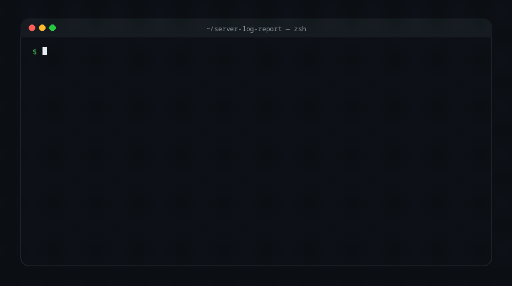

# server-log-report

[](https://github.com/gideonadeti/server-log-report/actions/workflows/ci.yml)
[](LICENSE)

Turn an nginx or Apache access log into a small Markdown traffic report — no
dependencies beyond the standard Unix tools.

```
| metric    | value  |
|-----------|-------:|
| requests  | 2000   |
| 4xx       | 429    |
| 5xx       | 495    |
| 5xx rate  | 24.75% |
```

Plus top IPs causing server errors, the most requested paths, a status-code
breakdown, and an optional uptime check.



## Why

Every server writes a log. Almost nobody reads it. This script does the boring
part: it reads yesterday's traffic and writes the five things you actually want
to know, in a file you can diff week over week.

It is deliberately small and hackable. Read it, change it, keep it in your own
dotfiles.

## Requirements

- `bash` (3.2+, so it works on macOS too)
- `awk`, `sort`, `uniq`, `wc`, `mktemp` — on every Unix
- `curl` — only if you use `--url`
- `gzip` — only if you use `--include-rotated`
- `jq` — only if you use `--json`

## Quick start

```bash
git clone https://github.com/gideonadeti/server-log-report.git
cd server-log-report

./report.sh --log /var/log/nginx/access.log --out-dir ./reports
cat reports/report_*.md
```

Try it without touching a real server:

```bash
./sample/generate-log.sh 500 > /tmp/access.log
./report.sh --log /tmp/access.log --out-dir /tmp/report
cat /tmp/report/report_*.md
```

## Usage

```
report.sh [options]

  -l, --log PATH        access log to read (default: /var/log/nginx/access.log)
                        use "-" to read from stdin
  -u, --url URL         health-check this URL before reporting
  -o, --out-dir DIR     where to write the report (default: ./reports)
  -n, --top N           rows per section (default: 5)
  -f, --format NAME     input format: combined (default), common, vhost_combined
      --fields F,F,F,F  custom field numbers: IP,PATH,STATUS,BYTES
                        (overrides --format)
      --since DATE      only count entries on or after DATE (YYYY-MM-DD)
      --until DATE      only count entries on or before DATE (YYYY-MM-DD)
      --json            print a JSON report to stdout instead of Markdown
      --csv             print a CSV report to stdout instead of Markdown
      --low-memory      bounded-memory mode: external sort instead of arrays
      --include-rotated read PATH.1 and PATH.*.gz as well
      --health-only     only run the health check, then exit
  -h, --help            show the help
  -V, --version         print the version
```

Examples:

```bash
# nginx, with an uptime check
./report.sh -l /var/log/nginx/access.log -u https://example.com

# Apache vhost logs
./report.sh -l /var/log/apache2/access.log --format vhost_combined

# a custom log_format: client IP is field 2, path 8, status 10, bytes 11
./report.sh -l /var/log/myservice/access.log --fields 2,8,10,11

# machine-readable output, ready for jq/other tools
./report.sh -l /var/log/nginx/access.log --json | jq '.summary'

# CSV for a spreadsheet
./report.sh -l /var/log/nginx/access.log --csv > report.csv

# only the last week (GNU date; macOS: date -v-7d +%F)
./report.sh -l /var/log/nginx/access.log --since "$(date -d '7 days ago' +%F)"

# a specific window
./report.sh -l /var/log/nginx/access.log --since 2026-11-01 --until 2026-11-07

# include rotated logs (a whole week, not just today)
./report.sh -l /var/log/nginx/access.log --include-rotated

# already-decompressed logs from stdin
zcat /var/log/nginx/access.log.*.gz | ./report.sh --log -

# just check that a site is up
./report.sh --health-only --url https://example.com
```

## Input formats

Field positions are what break when you point this at a new server, so they are
named instead of buried in the code.

| `--format` | IP | path | status | bytes | Typical source |
|---|---:|---:|---:|---:|---|
| `combined` (default) | 1 | 7 | 9 | 10 | nginx default, Apache "combined" |
| `common` | 1 | 7 | 9 | 10 | Apache "common" |
| `vhost_combined` | 2 | 8 | 10 | 11 | Apache vhost logs |

`common` shares positions with `combined` because the only difference is the
referrer/user-agent tail, which this script doesn't read.

For anything else, pass the four positions yourself:

```bash
./report.sh --log access.log --fields 2,8,10,11
```

Check before trusting it:

```bash
awk '{print NF}' access.log | sort -u    # consistent field count?
awk '{print $9}' access.log | sort -u    # do these look like status codes?
```

JSON-formatted logs are a different tool problem — use `jq` directly.

## Filtering by date (`--since` / `--until`)

`--since YYYY-MM-DD` keeps entries on or after that day; `--until YYYY-MM-DD`
keeps entries on or before it. Use either or both:

```bash
./report.sh --log access.log --since 2026-11-01
./report.sh --log access.log --until 2026-11-07
./report.sh --log access.log --since 2026-11-01 --until 2026-11-07
./report.sh --log access.log --since "$(date -d '7 days ago' +%F)"   # GNU date
./report.sh --log access.log --since "$(date -v-7d +%F)"             # macOS
```

It finds the `[DD/Mon/YYYY:...]` token wherever it appears in the line, so it
works with every supported format — including `vhost_combined`, where the date
sits in a different field — without a separate date-field option.

Because filtering happens after reading, it composes with `--include-rotated`:
load the whole rotated set, then report only the window you care about. Lines
with no recognisable date are dropped when either bound is set. A reversed
range (`--since` after `--until`) is rejected.

## JSON output

`--json` prints the whole report to stdout, so you can pipe it anywhere:

```bash
./report.sh --log access.log --json | jq '.summary.status_5xx'
./report.sh --log access.log --json > report.json
```

The shape is stable and meant for automation:

```json
{
  "generated_at": "2026-11-08T06:26:28Z",
  "source": "access.log",
  "format": "combined",
  "since": null,
  "until": null,
  "health": { "url": "https://example.com", "up": true },
  "summary": {
    "requests": 300,
    "status_4xx": 38,
    "status_5xx": 75,
    "error_rate_pct": 25.0,
    "bytes_served": 747766
  },
  "top_ips_by_5xx": [ { "ip": "192.0.2.44", "count": 23 } ],
  "top_paths": [ { "path": "/api/orders", "count": 58 } ],
  "status_codes": [ { "status": 200, "count": 164 } ],
  "malformed_lines": 0
}
```

`health` is `null` when `--url` isn't given. A failed health check writes an
error to stderr and exits non-zero, so a broken site never produces a report
that looks healthy. `--health-only --json` prints just the health object.

## CSV output

`--csv` prints a long/tidy table — one row per value, with a `section` column so
summary numbers, top IPs, top paths, and status codes can share one file:

```csv
section,key,value
meta,generated_at,"2026-11-08T06:30:18Z"
meta,source,"/var/log/nginx/access.log"
meta,format,"combined"
meta,since,2026-11-05
meta,until,2026-11-07
summary,requests,300
summary,status_4xx,38
summary,status_5xx,75
summary,error_rate_pct,25.00
summary,bytes_served,747766
summary,malformed_lines,0
top_ips_by_5xx,"192.0.2.44",23
top_paths,"/api/orders",58
status_codes,"200",164
```

Values are quoted and escaped per RFC 4180, so paths containing commas or
quotes survive intact (verified in the test suite). Load it with any
spreadsheet, `pandas.read_csv`, or `sqlite3`:

```bash
./report.sh --log access.log --csv > report.csv
python3 -c "import pandas as pd; print(pd.read_csv('report.csv').head())"
```

`--json` and `--csv` are mutually exclusive; pick one.

## Performance and memory

The default mode scans the log once, keeps per-key counts in memory, and sorts
only the unique keys. That is roughly four to five times faster than sorting
every line, but memory grows with the number of **unique** IPs and paths, not
with the file size.

On a 5M-line / 375 MB log with a handful of unique paths (development machine):

| mode | time | peak memory |
|---|---:|---:|
| default | ~7 s | ~4 MB |
| `--low-memory` | ~19 s | ~10 MB |

On a pathological 2M-line log with 2M unique paths:

| mode | time | peak memory |
|---|---:|---:|
| default | ~9 s | ~700 MB |
| `--low-memory` | ~9 s | ~10 MB |

So `--low-memory` is slower on normal logs but can be just as fast, and far
lighter, when cardinality is extreme. Use it on small machines or when the log
contains many unique URLs.

All modes set `LC_ALL=C`. Log fields are ASCII, and byte-wise collation is
significantly faster than locale-aware collation.

## Running it locally (e.g. `localhost:3000`)

Yes — the health check works against anything curl can reach:

```bash
# while your dev server is running
./report.sh --health-only --url http://localhost:3000
```

```
health: http://localhost:3000 is up
```

The **report** part needs an access log, and a dev server usually doesn't write
one. Three options:

1. Use the bundled sample log to exercise the report:
   ```bash
   ./report.sh --log sample/access.log --out-dir /tmp/report
   ```
2. Log requests from a tiny local server and point the script at it:
   ```bash
   python3 -m http.server 8000 2> /tmp/access.log
   ./report.sh --log /tmp/access.log --out-dir /tmp/report
   ```
   (Python's log lines are not in combined format, so this is for the uptime
   check, not the parsing. Use nginx if you want realistic data.)
3. Put nginx in front of your app locally and read its `access.log`.

## Log format

The script assumes the **combined** format, which is nginx's default and one of
Apache's defaults:

```
$1 client IP  $2 ident  $3 user  $4 [date  $5 tz]  $6 "METHOD  $7 path  $8 proto"  $9 status  $10 bytes  $11 referrer  $12 user-agent
```

Check before trusting it:

```bash
sudo awk '{print NF}' /var/log/nginx/access.log | sort -u   # should be consistent
sudo awk '{print $9}' /var/log/nginx/access.log | sort -u    # should be status codes
```

If your server uses a custom `log_format`, use `--fields` (or `--format`)
instead of editing the script. If your logs are JSON, this script is the wrong
tool — use `jq`.

## Permissions

`/var/log/nginx/` is usually readable only by root. Prefer one of these over
running the whole report as root:

```bash
# Debian/Ubuntu: add yourself to the adm group, then log out and back in
sudo usermod -aG adm "$USER"

# or grant a read ACL on the file
sudo setfacl -m "u:$USER:r" /var/log/nginx/access.log

# or run it with sudo (fine for a one-off)
sudo ./report.sh --log /var/log/nginx/access.log
```

## Log rotation

`access.log` only contains the current period. If logrotate is enabled,
older data lives in `access.log.1` and `access.log.*.gz`. Use
`--include-rotated` to read the current file, yesterday's, and the compressed
archives in one pass.

For a genuinely weekly report, either run this daily and keep the files, or
aggregate the rotated set. Keep an eye on disk usage: logs grow fast, and
compressing them is cheaper than storing them raw.

## Scheduling

cron:

```cron
0 8 * * 1 cd /opt/server-log-report && ./report.sh \
  --log /var/log/nginx/access.log --url https://example.com \
  --out-dir /var/reports >> /var/log/server-report.log 2>&1
```

Note that cron starts with a minimal `PATH`, so use absolute paths or set
`PATH` inside the crontab.

systemd timer (nicer logs and failure handling):

```ini
# ~/.config/systemd/user/server-report.service
[Unit]
Description=Weekly server log report

[Service]
Type=oneshot
WorkingDirectory=%h/opt/server-log-report
ExecStart=%h/opt/server-log-report/report.sh --log /var/log/nginx/access.log --out-dir %h/reports
```

```ini
# ~/.config/systemd/user/server-report.timer
[Unit]
Description=Run the server report every Monday

[Timer]
OnCalendar=Mon 08:00
Persistent=true

[Install]
WantedBy=timers.target
```

```bash
systemctl --user enable --now server-report.timer
```

## Notes and limitations

- **IPs are personal data.** If you publish or share reports, consider hashing
  or removing them (GDPR-minded readers will thank you).
- **Behind a proxy/CDN** (Cloudflare, a load balancer), the logged IP is the
  proxy's, not the visitor's. Configure `real_ip` in nginx or read
  `X-Forwarded-For` if that matters.
- **Custom log formats** need the right field numbers. Use `--format` for the
  built-in layouts or `--fields` for anything else; the script warns if lines
  have fewer fields than the format expects, but it cannot know your layout.
- **This is a summary, not analytics.** It answers "is anything on fire?"
  For funnels, retention, and dashboards, use a real analytics product.

## License

MIT — see [LICENSE](LICENSE).
